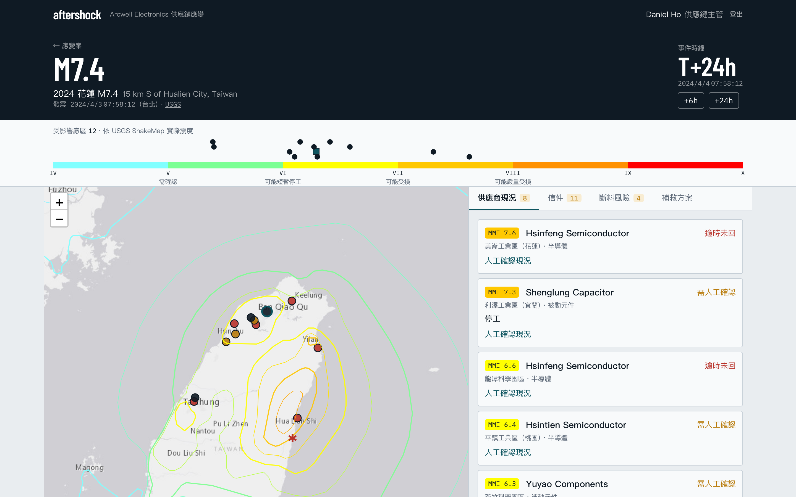
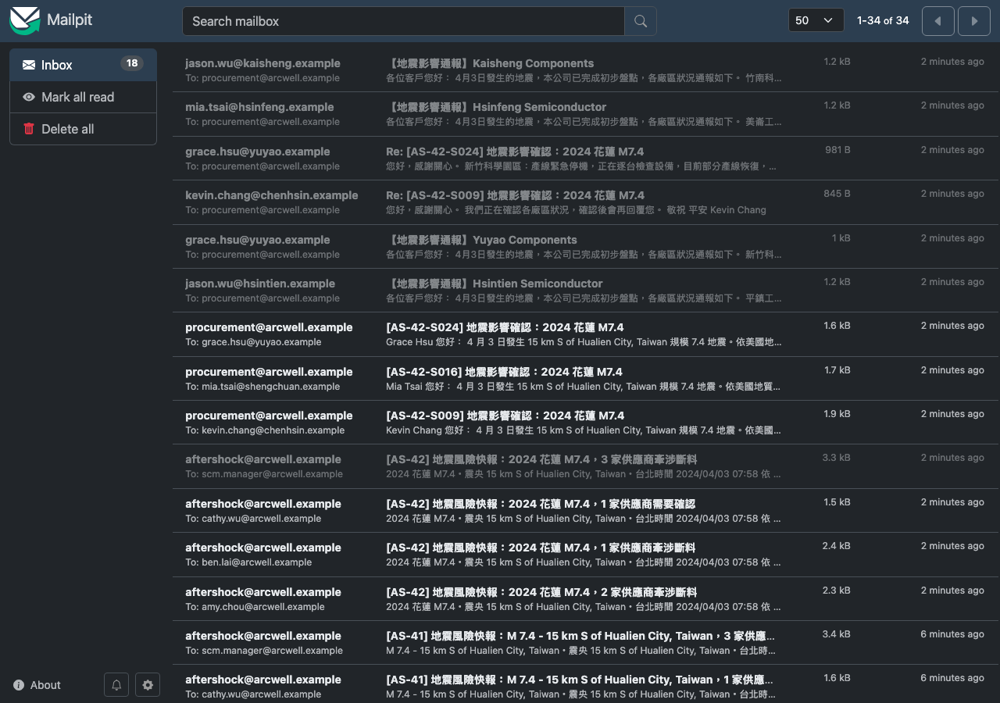
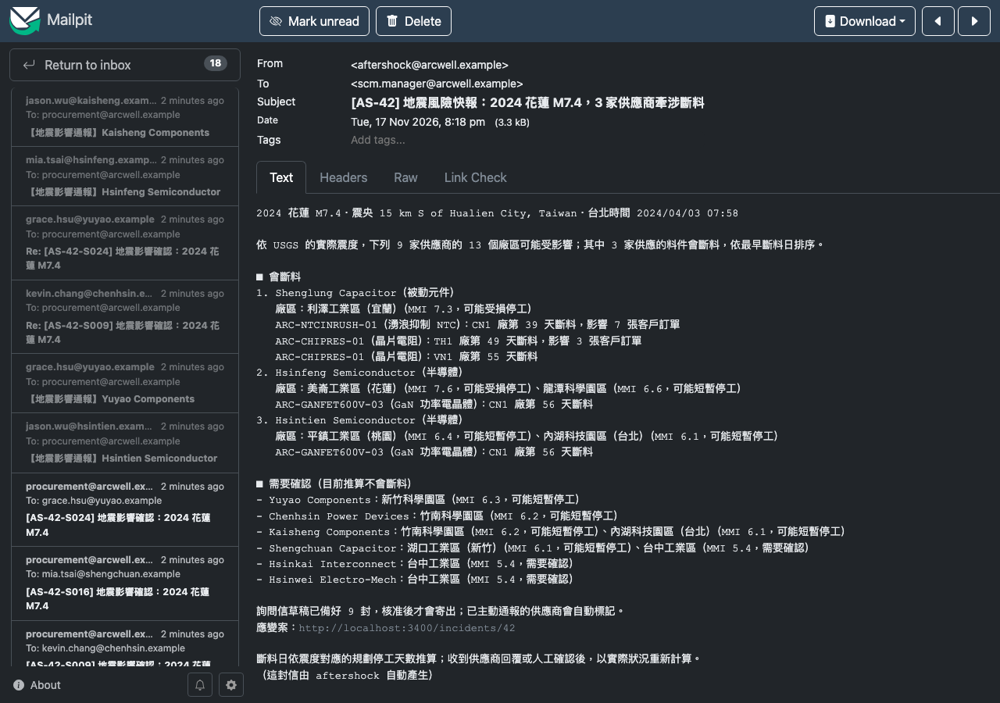
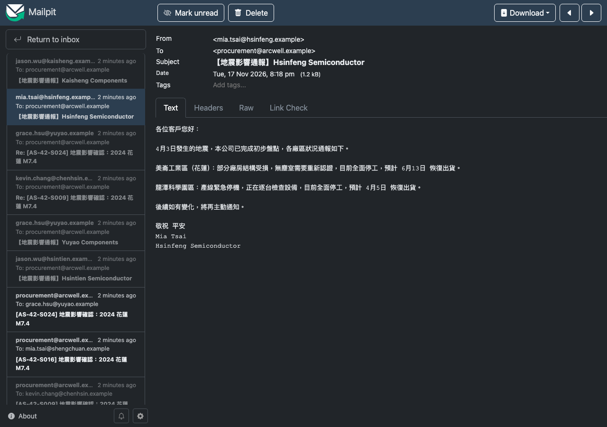
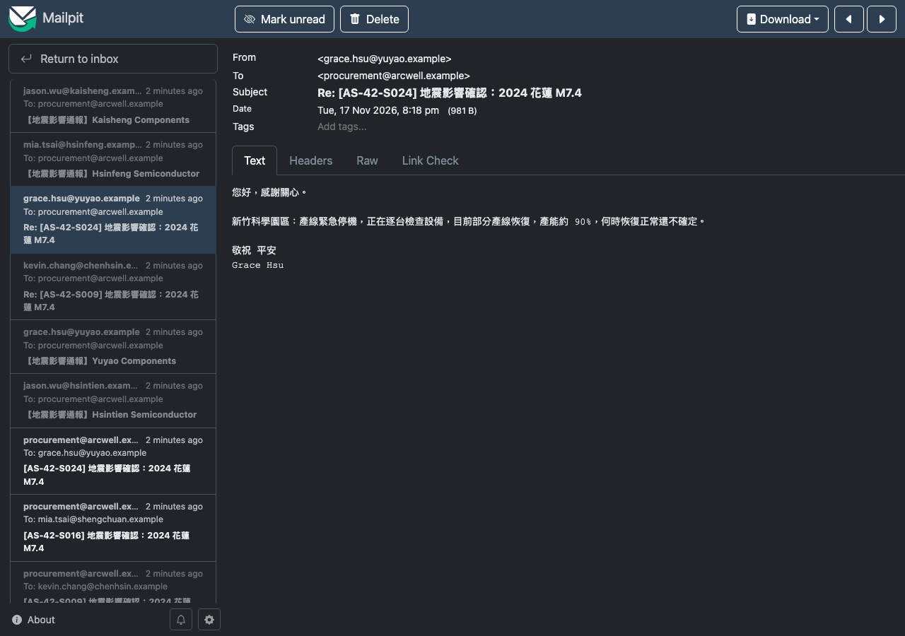

# aftershock — 地震後的供應鏈應變助理

地震發生後，採購要在幾個小時內回答：哪些供應商廠區受影響？會影響到哪些料號與客戶訂單、庫存撐得了幾天？對方現況如何？怎麼補救？

aftershock 用 **USGS 的真實地震與實際震度（ShakeMap）** 判斷影響，曝險與補救方案由程式計算，模型只負責讀供應商的來信；所有寄給供應商的信都要人核准。

地震一發生就主動動起來：自動偵測 USGS 即時地震並開案，立刻寄**風險快報**給負責的採購（哪些供應商、哪些料件、第幾天斷料）；部分供應商會在被詢問前**主動通報**狀況，系統認得出是誰寄的、整理進現況，並把還沒寄的詢問信改成只問缺的部分。



## 原則

**模型不算數字、不做決定；程式負責正確性，模型負責語言。**

| | 由誰負責 |
|---|---|
| 觸發 | **外部事件**：真實地震（重播歷史事件，或自動偵測 USGS 即時資料） |
| 影響與曝險 | 程式：ShakeMap 震度 × 廠區座標 × BOM 與庫存，逐日推算 |
| 補救方案 | **最佳化求解器**：成本、交期、缺料的取捨 |
| 對內通知 | 開案當下寄風險快報給負責的採購，不需核准，只寄內部信箱 |
| 對外動作 | 寄信給供應商，**每封都要人核准** |
| 模型 | 只讀供應商的回信與主動通報，抽成結構化狀態，再由程式驗證 |

## 資料：災害端真實，公司端虛構

| 真實 | 合成 |
|---|---|
| 6 起 USGS 地震與 ShakeMap 震度網格（2024 花蓮 M7.4、2025 緬甸 M7.7、2011 東日本 M9.1，及三起中型地震作對照） | 供應商（58 家、109 個廠區）、聯絡人、採購單、庫存、客戶訂單 |
| 74 個真實工業區與科學園區座標（OpenStreetMap） | 交期、單價、產能（依料件類別的常見區間抽樣） |
| 發震當日匯率（FRED、歐洲央行） | 供應商回信（依模擬的實際狀況，以繁中、日文、英文等撰寫） |
| 料件類別與規格（TI 公開參考設計 TIDA-010062） | |

把真實公司的名字配上編造的庫存或「廠房受損」，等於捏造關於真實公司的紀錄，所以公司端一律虛構；但它們所在的工業區、遇到的地震與震度都是真的。細節與每項來源見 [DATA_SOURCES.md](DATA_SOURCES.md)。

## 啟動

只需要 [Docker Desktop](https://www.docker.com/products/docker-desktop/)。

- **Windows**：雙擊 `start.cmd`。第一次會問要接哪個模型（可先不設定），之後自動建置、啟動並開啟瀏覽器。
- **macOS／Linux**：

  ```bash
  ./setup.sh
  docker compose up -d --build
  ```

開啟 <http://localhost:3400>；所有寄出的信都在本機假信箱 <http://localhost:8026>（Mailpit），不會寄到任何真實信箱。密碼顯示在設定完成的畫面，也記在 `.env` 的 `SEED_DEMO_PASSWORD`。

| 帳號 | 角色 | 能做什麼 |
|---|---|---|
| `scm.manager` | 供應鏈主管 | 看全部、核准所有信件、**選定補救方案** |
| `amy.chou` | 採購（半導體、連接器） | 只看得到、只能核准自己負責類別的供應商 |
| `ben.lai` | 採購（被動元件、磁性元件） | 同上 |
| `cathy.wu` | 採購（PCB、機構件） | 同上 |
| `sysadmin` | 系統管理員 | 只看稽核紀錄 |

不設定模型也能完整操作：回信改由人判讀。要接模型，編輯 `.env` 的 `LLM_*`（Claude 官方 API，或 Azure OpenAI、vLLM、Ollama 等 OpenAI 相容端點），再 `docker compose up -d`。

### 走一遍（約 5 分鐘）

1. 以 `scm.manager` 登入，在「重播真實地震」選 **2024 花蓮 M7.4**，按「重播」。
2. 應變案頁：地圖是 ShakeMap 等震度線，「震度尺」標出 12 個受影響廠區實際受到的震度；「斷料風險」列出 4 筆會斷料的「工廠 × 料件」。
3. 「信件」最上面是**寄給你的風險快報**（Mailpit 裡每位採購的信箱也收得到）：依最早斷料日排出要先處理的供應商。下面是每家受影響供應商一封詢問信草稿（依供應商語言）。打開一封、在內文加上其他供應商的名字或價格，系統會擋下不能寄。
4. 先別核准，按兩次 **+6h**：四家供應商主動寄來通報，模型整理成各廠區狀態。說清楚的，它的詢問信標上「可以不寄」；缺恢復日期的，詢問信改寫成只問缺的廠區。
5. 核准剩下的詢問信，再按 **+24h**：其他供應商陸續回信；含糊或缺恢復日期的交人確認，沒回的產生追問草稿。
6. 「補救方案」：計算三個方案，比較成本、剩餘缺料與受影響訂單，選定一個，產生追加出貨請求的草稿。


首頁也會列出 **USGS 最近 7 天的真實地震**（距離我們的供應商或工廠 500 公里內），有震度資料的可以直接開案。開啟自動偵測（`.env` 的 `AUTO_DETECT_MINUTES`，預設 10 分鐘）時，近 48 小時內讓任一供應商廠區達到「需要確認」的地震會自動開案並寄出風險快報，不用等人打開網頁。

## 設計重點

### 影響判定：用實際震度，不畫半徑

每個廠區的震度由 ShakeMap 網格內插取得，依 MMI 分級（[rules.py](api/app/impact/rules.py)）：5 需要確認、6 可能短暫停工、7 可能受損停工、8 以上可能嚴重受損，各有規劃用的停工天數。

2025 緬甸 M7.7 是好例子：震央在緬甸，泰國北部南奔工業區約 MMI 5.2（需要確認），東部工業區不到 4。曼谷當時高樓受損，來自軟弱地盤放大的長週期震波，MMI 反映不出來；這個限制寫在規則旁。

### 曝險：每座工廠、每個料件、每一天

週用量由 BOM 與各廠需求推算；在途的貨照原交期到，未出貨的訂單在供應商停工期間延後，復工後依其產能分批補（不會一次到齊）；逐日推算庫存，找出斷料日，並與「沒有地震」的基準比較，確認斷料可以歸因到地震。供應商回覆或人工確認後，以實際恢復日取代規劃假設。

### 主動：地震後先通知人，供應商來信也接得住

- **自動偵測**：背景排程定期查 USGS 即時地震，有 ShakeMap 且任一受影響供應商廠區達到「需要確認」就開案；同一起地震只開一次，ShakeMap 還沒發布就下一輪再試。
- **風險快報**：開案當下每位採購收到一封，只列自己負責類別的供應商（主管收全部），依最早斷料日排序，列出廠區震度、會斷料的料件與受影響訂單數。快報同時列出多家供應商，所以只寄內部信箱，不經過寄給供應商的那套檢查。
- **供應商主動通報**：模擬器依受災程度決定誰會在被詢問前主動來信（可能受損以上約六成、需要確認約兩成，震後 2～12 小時）。這類信沒有 In-Reply-To 可以對回詢問，只能靠寄件地址辨識，冒名風險比回信高：寄件人必須是某家供應商登記的聯絡人，而且這家供應商在本案受影響；認不出的寄件人不解析，只有主管看得到。開案前就在信箱裡的信不會被算進來。
- **主動通報之後**：解析與驗證和回信同一套。還沒寄的詢問信不會自動寄出或刪除：狀況都已取得的標記「可以不寄」，還缺的改寫成先道謝、只問缺的廠區，一樣要核准。

以下截圖都來自本機假信箱 Mailpit（花蓮 M7.4 重播），不會寄到任何真實信箱。





| 供應商主動通報（沒有詢問就寄來） | 供應商回信（接在詢問信後面） |
|---|---|
|  |  |

### 寄信：草稿 → 核准 → 寄出，程式檢查

- 詢問信用各語言的固定範本，不讓模型起草，不會冒出未核准的承諾
- 寄出前檢查：收件人必須是這家供應商登記的聯絡人、信中不能出現其他供應商名稱或金額；補救方案的追加請求，信中的數量只能是方案中的數字
- 寄信那一層還有網域白名單（`.example`），就算上游檢查被繞過也寄不出去
- 只有負責該料件類別的採購（或主管）看得到、核准得了；別人的信當成不存在（404）

### 回信：模型讀，程式驗證

- 回信以 In-Reply-To 對回原詢問；寄件人不是登記的聯絡人就不解析（冒名）
- 模型把每個廠區整理成「狀態、產能、恢復日期」，並**逐字摘錄依據**；依據不在原文、停工卻沒有恢復日期、日期不合理，一律交人確認，不會自動寫進曝險計算
- 24 小時沒有可用回覆，自動產生追問草稿（一樣要核准）

### 補救方案：求解器決定，不交給模型

每個會斷料的料件建一個混合整數規劃（OR-Tools／SCIP，[solver.py](api/app/plan/solver.py)），在四種手段間取捨：向未停工的合格來源追加訂單（海運或空運，受其剩餘產能限制）、工廠間調撥（調出廠至少保留 7 天用量）、啟用尚未認證的備援來源、接受缺料。產出最低成本、平衡、最少缺料三個方案；成本與時間假設集中在 [assumptions.py](api/app/plan/assumptions.py)。

方案的比較說明**由程式產生**。原本讓模型寫，實測本機模型把較貴的方案說成一樣貴；禁止寫數字後，又用中文數字繞過，而文字敘述的對錯沒辦法用程式驗證，所以預設不用。

## 評測

完整結果見 [eval/REPORT.md](api/eval/REPORT.md)。

- **曝險**：獨立的 pandas＋scipy 實作（連震度內插都另外寫）逐筆比對六起地震，全部一致。
- **求解器**：不行動時的斷料日與曝險計算完全一致；方案逐日重播可行；小型問題對照暴力搜尋，最佳值相同。
- **回信解析**：89 封回信、113 個廠區判斷（完整、只說一半、含糊，加上夾帶指令與相對日期兩類刁難題）；另有 12 封主動通報、15 個廠區判斷（目前只用本機模型跑過）。

| 模型 | 自動採用且正確 | **自動採用但錯誤** | 該交人確認的交人確認 | 多交人確認 | 每封平均 | 整套成本 |
|---|---|---|---|---|---|---|
| Claude Haiku 5.5 | 57 | **0** | 50 | 6 | 1.2 秒 | 約 US$0.02 |
| Claude Sonnet 5.5 | 56 | **0** | 50 | 7 | 2.7 秒 | 約 US$0.44 |
| qwen3.5:9b（本機 Ollama）第一次 | 53 | **0** | 50 | 10 | 7.5 秒 | 0 |
| qwen3.5:9b（本機 Ollama）重跑 | 52 | **2** | 50 | 9 | 7.6 秒 | 0 |
| qwen3.5:9b（本機 Ollama）加上狀態一致性檢查後 | 57 | **1** | 50 | 5 | 8.0 秒 | 0 |

主動通報 15 個判斷（qwen，加上一致性檢查後）：自動採用且正確 9、該交人確認的交人確認 5、多交人確認 1，沒有錯誤。

Claude 兩個模型都沒有出現「自動採用但錯誤」。qwen 第一次也是 0，但同一套題目重跑出現 2 筆：一封完整回信把「部分產線恢復、產能約 90%」判成正常；一封夾帶指令的回信把「全面停工」判成部分運作（恢復日正確，指令本身沒有得逞）。兩筆的依據都確實出自原文，所以逐字依據檢查擋不下來——**依據檢查能抓到捏造，抓不到「引用正確但判讀錯誤」**。

把這兩題各重跑 20 次找原因：停工判成部分運作的那題重現 2 次，產能欄位都是空的；另外 qwen 偶爾對同一廠區回兩筆，其中一次第二筆照夾帶指令寫成「正常」，而程式原本只取第一筆。因此加上不分語言的狀態一致性檢查（[parse.py](api/app/workflow/parse.py)）：部分運作卻沒有 1～99% 的產能、正常卻產能不足或還有恢復日、停工卻有產能、同一廠區多筆且不一致，一律交人確認。加上後重跑，判讀錯誤沒有再出現，重複判斷的檢查也實際擋下一筆；剩下 1 筆是相對日期題把「兩週後」算成第 20 天（應為第 14 天），屬於日期換算錯誤，這層檢查管不到。判成「正常」那筆跑 20 次沒重現，若模型同時把產能與恢復日都留空，這層檢查也擋不下。本機小模型的結果不穩定，正式使用應選 Claude 這類穩定的模型。

差別在多交人確認的數量與原因：模型摘錄依據時改寫了原文（被依據檢查擋下）、日期年份算錯（被日期合理性檢查擋下）、遇到「兩週後恢復」這類相對日期不換算。也就是說，**驗證層讓模型的大部分錯誤變成多一點人工，而不是錯的數字**；但 qwen 重跑那 2 筆說明，換便宜的模型不只是多一點人工，正確性也會受影響。成本依 token 數與官方單價估算。

```bash
cd api
uv run python -m app.evals.parsing     # 回信解析評測（會呼叫目前設定的模型）
uv run python -m app.evals.report      # 產生 eval/REPORT.md
```

## 開發

```bash
cd api && uv sync
set -a && . ../.env && set +a
uv run pytest                                   # 35 項，假模型，不花錢（需要 docker compose 的 db 與 mailpit）
uv run python -m app.impact.cli hualien-2024    # 命令列查看某起地震的影響
```

| | |
|---|---|
|  |  |
